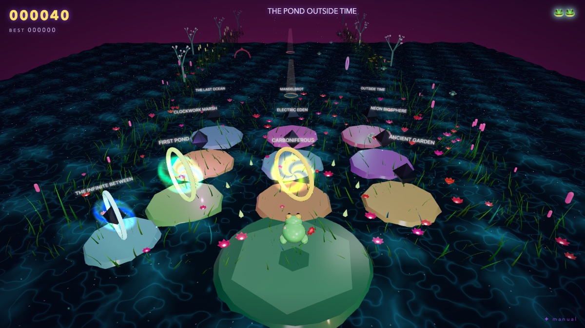

# MANDELHOP 🐸 — THE INFINITE DESCENT
*one endless frogger journey into a recursive psychedelic garden*



No stages. No arcade loop. One continuous procedurally-generated track that
keeps unfolding deeper into the Mandelbrot dream — and keeps finding new
ways to kill you.

## Run

```bash
python3 -m http.server 8080        # or: npm run dev
```
Open http://localhost:8080. Everything is local (three.js is vendored in
`node_modules`) — no internet needed.

## Controls
←↑↓→ / WASD / swipe / gamepad — hop (hold to keep hopping) · Space — start ·
P pause · M sound · C camera (classic ↔ immersive) · R instant restart ·
F performance HUD

## The Descent

- **Distance is the score.** +10 per new row, +25 per pollen orb (also +3s
  bloom energy), +250 per checkpoint mandala (also refills energy & sets
  your respawn). 3 lives. Best score & deepest depth persist.
- **Biomes blend every 30 rows**: Neon Garden → Dusk Highway → Sapphire
  River → Jade Wetland → Psychedelic Rainforest → Alien Jungle → Fractal
  Ocean → Mandelbrot Temple → Recursive Cosmos → loops faster. Sky, water,
  flora, traffic and the music's root all cross-fade continuously.

### Complications unlock with depth
| depth | complication |
|---|---|
| 40 | **Dragonflies** stalk, telegraph, and dash across your row |
| 60 | **Sinking lilies** — red-veined pads dip under after ~1.4 s |
| 90 | **Portal rows** — non-Euclidean torus lanes: hop off one edge, arrive at the other (platforms carry you through) |
| 120 | **Sheared space** — rows slide ±½ tile sideways |
| 150 | **Mirror zones** — violet pillars: left is right · **Snakes** patrol safe rows |
| 200 | **The Mandelbrot Pulse** — lane speeds breathe via orbit-trap iteration |
| 250 | **Chompers** — carnivorous blooms snap on a cycle |

Plus **wormhole pairs** on safe rows from depth 90. Every mechanic is
announced by a banner the first time it can appear.

## Technique

- **Deterministic unfairness-free core**: all lanes are constant-velocity
  with seeded generation per run; water waves, bobbing, pulse visuals are
  render-only. Collision uses grid math on the same numbers you see.
- **Infinite track**: rows generated 45 ahead / pooled & recycled 25 behind;
  vegetation in 24-row chunks keyed to biome genomes; water is a single
  world-anchored plane masked per-row by a sliding 128-row DataTexture.
- **Water**: analytic spectral waves (JONSWAP-inspired, adapted from
  poseidon MIT), Fresnel/SSS/glitter/caustic-web/foam, interactive ripple
  rings on every frog impact.
- **Vegetation**: instanced ribbon blades, sway-factor wind (adapted from
  gaia MIT), frog-parting, hop-triggered bloom waves, beat-synced breathing.
- **Sky**: kaleidoscopic Julia/Mandelbrot dome whose seed morphs between
  biomes — the sky itself descends with you.
- **Audio**: fully generative Web Audio — hops climb a pentatonic ladder,
  biome crossings swell, dragonfly telegraphs glissando, wormholes swoop,
  checkpoints resolve the phrase. No recordings.
- ~120 fps on Apple Silicon; instancing, pooling, blob shadows, capped DPR.

## Credits
Adapted techniques (MIT, © 2026 owenyuwono — see LICENSES.md):
**poseidon** (spectral water) · **gaia** (grass genomes & wind).
three.js (MIT) vendored locally. All game code original.


---

## ⧗ TIMEWARP EXPANSION (v2)

MANDELHOP is now a full **psychedelic 3D platforming campaign** in the spirit of late-90s linear platformers — built around **TIME**.

- **THE POND OUTSIDE TIME** — a hub that awakens (plants, lanterns, crystals, the crown) as you complete worlds
- **9 temporal worlds × 4 stages** (3 stages + a traversal-tested **Guardian** boss each)
- **Progressive powers**: Cyclone Spin → Double Jump → Super Belly Slam → Seed Shot → Slide → Tongue Grapple → Super Spin → Time Dash — each unlocked by a guardian ceremony, each re-opening older stages
- **Time powers**: SLOW (hold T) · FREEZE (F) · PHASE SHIFT (G) · REVERSE (B — rebuild fallen ruins, lift sinking pads) · ACCELERATE (N — grow seeds into bounce mushrooms)
- **Hop Flow → FLOW STATE**: rhythm-chained landings turn the level into an instrument (generative percussion, blooms, score ×2)
- **Chronopods** (13 variants), Time Pollen, Fractal Shards, Secret Glyphs, Perfect/No-Death/Seeker/Pollen Blooms
- **TIME RUN** speedrun mode: stopwatch, time pods, tiered Epoch relics, and your **translucent time-ghost** with ribbon trail
- **Chase stages** (the fractal serpent looms), **bonus dimensions**, **death routes**, **phase-shifted rivers**, collapsing ruins, spitter plants whose spores you reflect, beetles that demand the right power
- The original **endless descent** survives as THE INFINITE BETWEEN (hub gate, left side)

### Controls
`←↑↓→ / WASD` hop · `J` spin · `K` slam · `L/Shift` slide · `I` seed shot · `U` grapple · `H` time dash · `T` hold = slow · `F` freeze · `G` phase · `B` reverse ruins · `N` accelerate growth · `R` retry · `Q` hub · `C` camera · `P` pause · `M` mute

Accessibility: FLASH/MOTION toggle on the title screen. Gamepad: dpad/stick hop · A confirm · X spin · B slam · Y seed · LB slide · RB dash · LT slow · RT freeze.

### QA harness (`qa/`)
`node qa/serve.mjs` then: `smoke.mjs` (error sweep) · `bot.mjs <stage> <new|pro>` (heuristic player agents) · `tour/powers/endgame/features.mjs` (screenshot suites) · `killpath.mjs` (boss E2E).
